<div align="center">


# MatDo

**Aufgaben, Projekte und Teams – mit einer Schnelleingabe wie bei Todoist und einem Webhook für Sprachbefehle.**

Selbst gehostet: ein App-Container und PostgreSQL. Port **6006**.

</div>

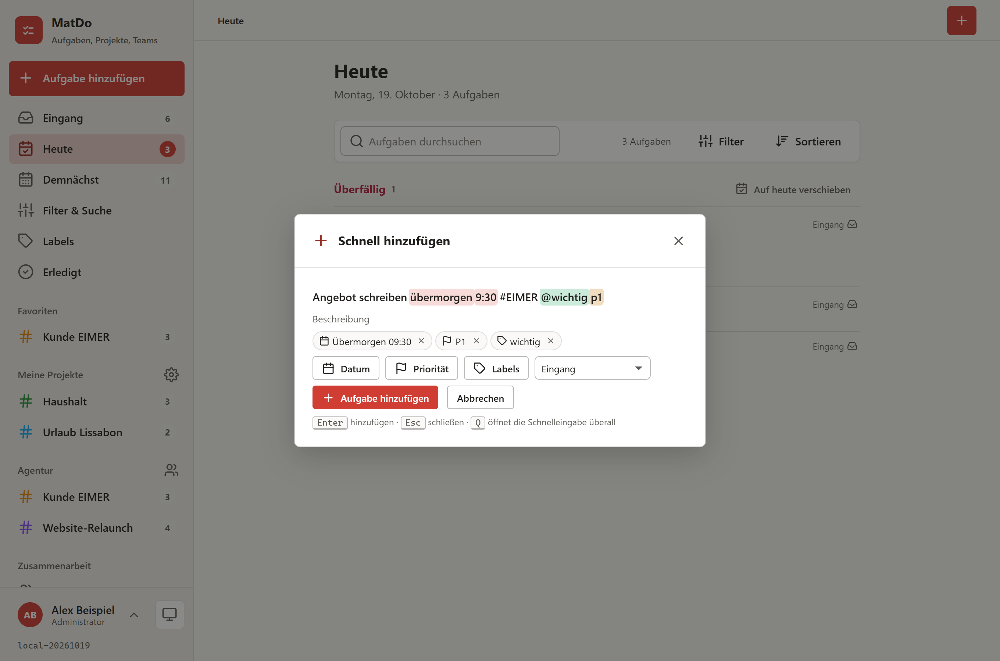

---

## Auf einen Blick

**Aufgaben wie in Todoist**
- **Schnelleingabe** in einer Zeile: `Angebot schreiben übermorgen 9:30 Projekt Kunde EIMER @wichtig p1` – erkannte Teile werden **im Text markiert** und als Chips angezeigt; ein ✕ am Chip schaltet die Erkennung für diese Art ab
- Datum (mit Kalender, Uhrzeit und Wiederholung), Priorität, Labels und Projekt zusätzlich per Button – dieselben Felder auf der Seite einer Aufgabe; alle Tastenkürzel unter *Einstellungen → Hotkeys*
- **Eingang**, **Heute** (mit Überfälligem und „Auf heute verschieben“), **Demnächst** (14 Tage, pro Tag ein Editor), **Filter & Suche**, **Labels**, **Erledigt**
- **Projekte** mit **Abschnitten**, Farben, Favoriten, Archiv; **Unteraufgaben** eingerückt direkt in der Liste (beliebig tief, zum Abhaken und Zuklappen), **Kommentare**, **Fristen**, **Wiederholungen**, Prioritäten **p1–p4**
- Abhaken ohne Neuladen; eine wiederkehrende Aufgabe springt auf den nächsten Termin; **Drag & Drop** für die Reihenfolge; auf dem Smartphone **Wischen** (rechts: erledigt, links: morgen / löschen) und **langes Drücken** für das Menü
- **Live:** eine diktierte Aufgabe oder eine Änderung auf einem anderen Gerät erscheint sofort im offenen Fenster
- **Benachrichtigungen** (Web Push, auch als installierte App auf dem iPhone): Erinnerung zur Uhrzeit einer Aufgabe (oder 10/30/60 Minuten vorher), Tagesübersicht, Zahl der fälligen Aufgaben am App-Icon, „Erledigt“ und „Morgen“ direkt in der Benachrichtigung
- **Offline:** ohne Netz eine Offline-Seite, auf der neue Aufgaben notiert werden – sie kommen in den Eingang, sobald das Netz zurück ist, gelesen wie beim Webhook

**Natürliche Sprache (Deutsch und Englisch)**

| Art | Beispiele |
|---|---|
| Datum | heute, morgen, übermorgen, am Freitag, nächsten Montag, übernächsten Freitag, in 3 Tagen, nächste Woche, **nächste Woche Mittwoch**, **Mittwoch nächster Woche**, übernächste Woche, am Wochenende, Monatsende, 24.12., 24.12.2027, 24. Dezember, 2026-12-24 · today, tomorrow, next friday, **next week friday**, week after next, Dec 24 |
| Uhrzeit | um 15 Uhr, 15:30, 9.30 Uhr, um halb 4, um 7 abends, morgen früh, heute Abend, 3pm, **in 10 min**, **in 2 Stunden**, in einer halben Stunde · in 15 minutes, in an hour |
| Erinnerung | *„Erinnerung in 10 min an Waffel“* → „Waffel“ in 10 Minuten · *„Remind me tomorrow at 8 to call Bob“* → „call Bob“ |
| Wiederholung | täglich, jeden Tag, werktags, jeden Montag, jede Woche, alle 2 Wochen, jeden Monat, jeden 15., jährlich · every day, every monday |
| Projekt / Abschnitt | `#Projekt` (auch mit Leerzeichen, z. B. `#Haus und Garten`), `/Abschnitt` |
| Label / Priorität | `@label`, `p1` … `p4` |
| Frist | `{Freitag}` |
| **Schlüsselwörter** | `Projekt EIMER`, `Label Einkauf`, `Priorität 1` / `Priorität hoch`, `Abschnitt Planung`, `Frist Freitag`, `Beschreibung …` (der Rest wird die Beschreibung) |

Die **Schlüsselwörter** legt jede Person unter *Einstellungen → Schlüsselwörter* fest (z. B. „Projekt“, „für Projekt“, „Kunde“) – mit einem Feld zum Ausprobieren. Ideal für Diktat: *„Projekt EIMER Angebot schreiben übermorgen um 9 Uhr Priorität 1.“* Satzzeichen der Diktierfunktion werden entfernt.

**Teams**
- Teams mit Eigentümern und Mitgliedern; Mitglieder werden über die E-Mail-Adresse ihres Kontos hinzugefügt
- **Teamprojekte** sieht und ändert jedes Mitglied; Aufgaben lassen sich Mitgliedern **zuweisen**
- Wer ein Team löscht, behält dessen Projekte als persönliche Projekte

**Webhook – Aufgaben per Sprache (Apple Kurzbefehle)**
- Beliebig viele Webhooks pro Person (*Einstellungen → Webhooks*), jeweils mit eigenem Ziel-Projekt, an/aus, neue Adresse erzeugen
- `POST /api/v1/webhook/{token}` – derselbe Parser wie die Schnelleingabe, inkl. der eigenen Schlüsselwörter (Details unten)

**Oberfläche**
- **Englisch und Deutsch** (EN / DE): Sprache aus dem Konto, sonst aus dem Umschalter der Anmeldeseite, sonst aus dem Browser. Datumsangaben, Wiederholungen, Meldungen und die Antworten des Webhooks folgen der Sprache; die Schnelleingabe versteht immer beide
- **Menü-Umschalter unten** im Menü: *Aufgaben*, *Einstellungen* (Profil, Schlüsselwörter, Webhooks, Benachrichtigungen, Hotkeys, Passwort, Deine Daten) und – für Administratoren – *Administration* (Benutzer, System)
- **Deine Daten (DSGVO):** alles als JSON herunterladen und das Konto endgültig löschen; Team-Projekte bleiben beim Team
- Design von [MatDesign](https://github.com/Real-TTX/MatDesign) (MatUi), hell/dunkel, Smartphone. Das erste Konto ist der Administrator.

## Screenshots

| Heute | Demnächst |
|---|---|
| 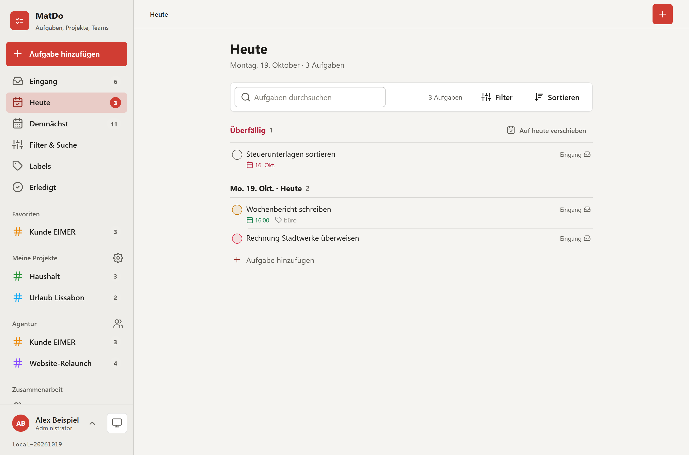 | 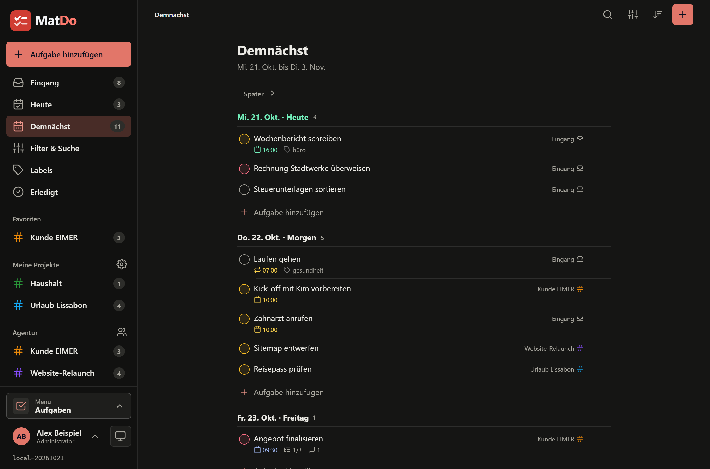 |

| Projekt mit Unteraufgaben | Aufgabe |
|---|---|
| 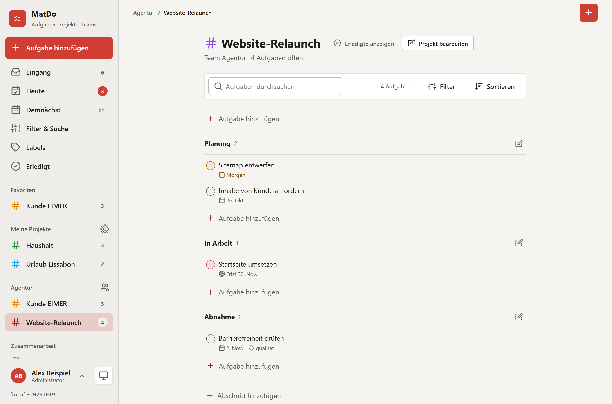 | 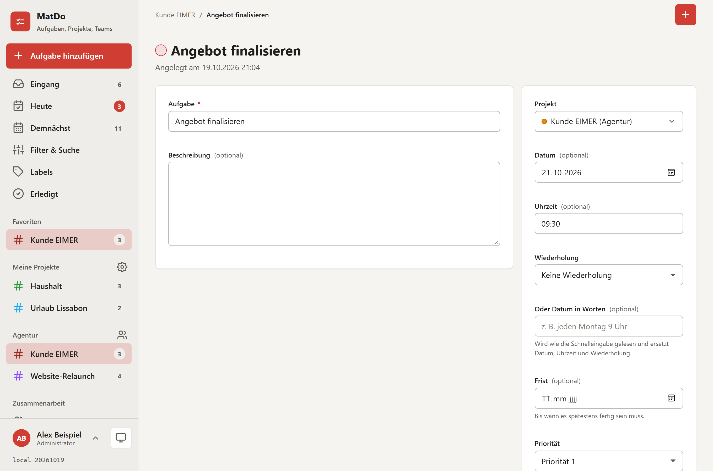 |

| Schlüsselwörter mit „Ausprobieren“ | Webhook mit Anleitung |
|---|---|
| 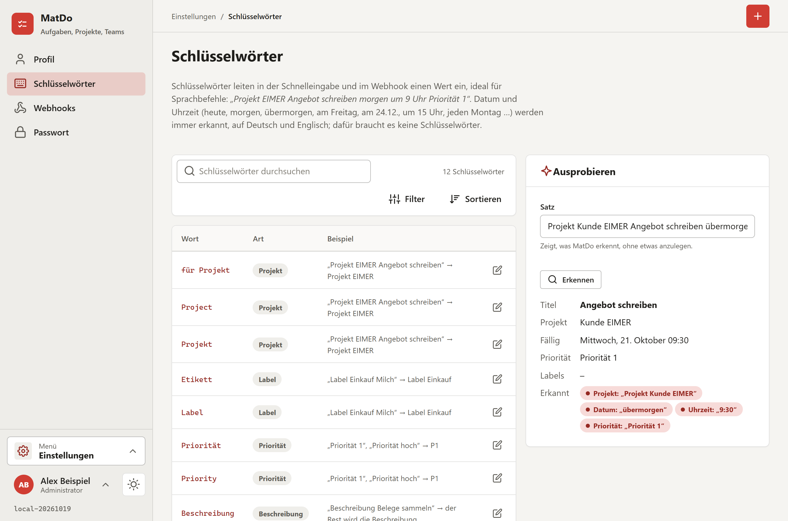 | 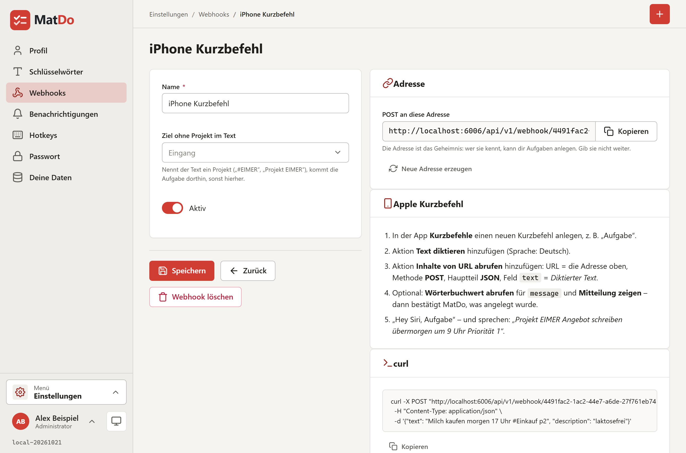 |

| Team | Benutzer (Administration) |
|---|---|
| 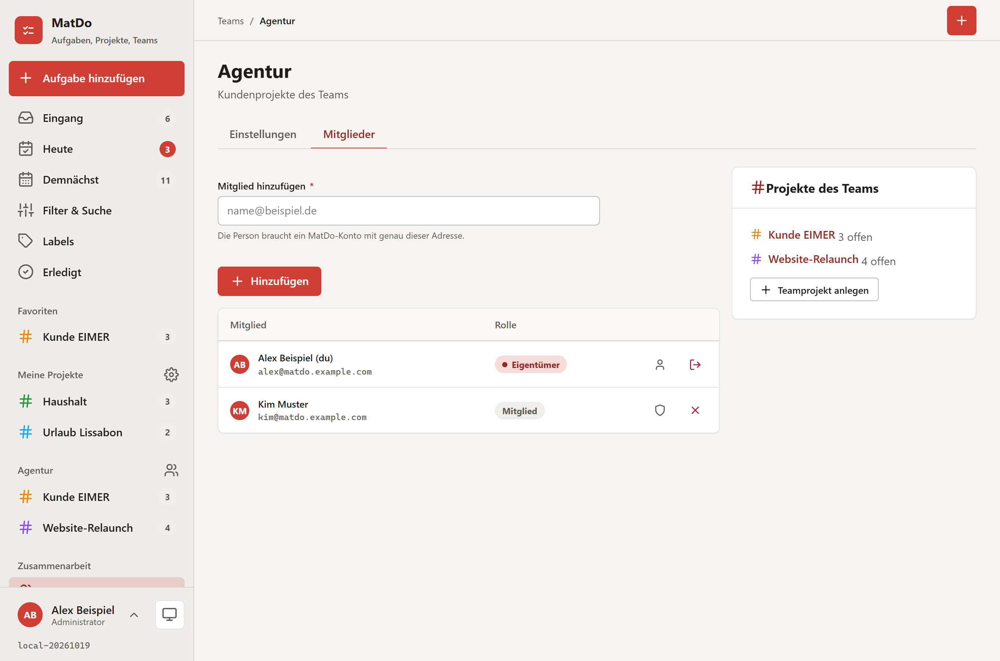 | 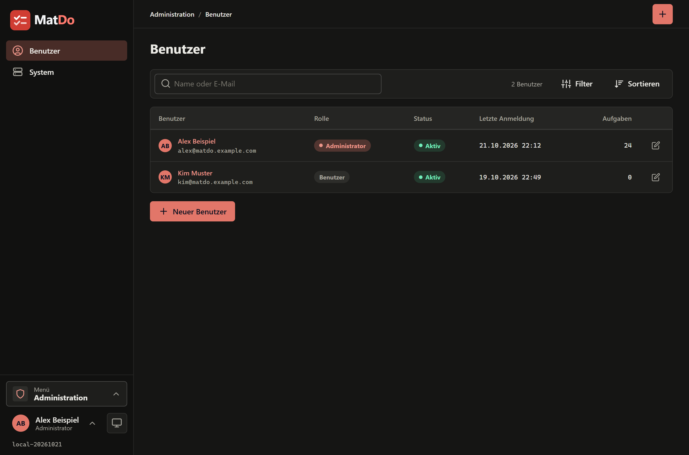 |

| Benachrichtigungen | Deine Daten (DSGVO) |
|---|---|
| 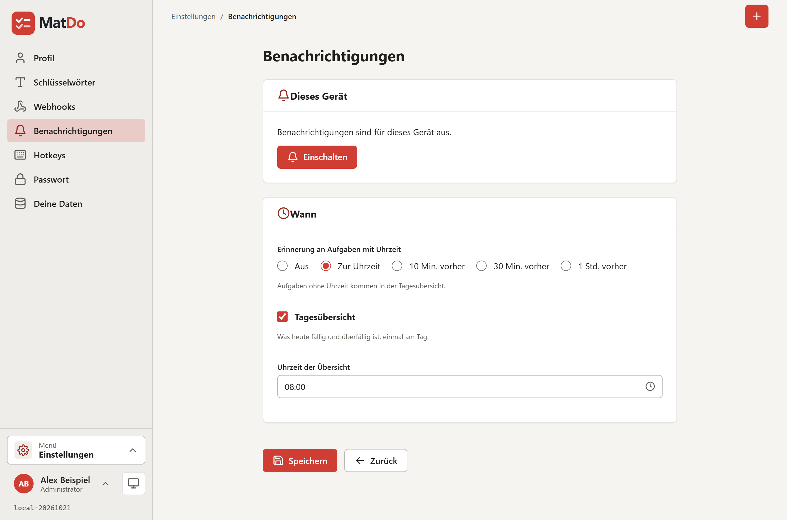 | 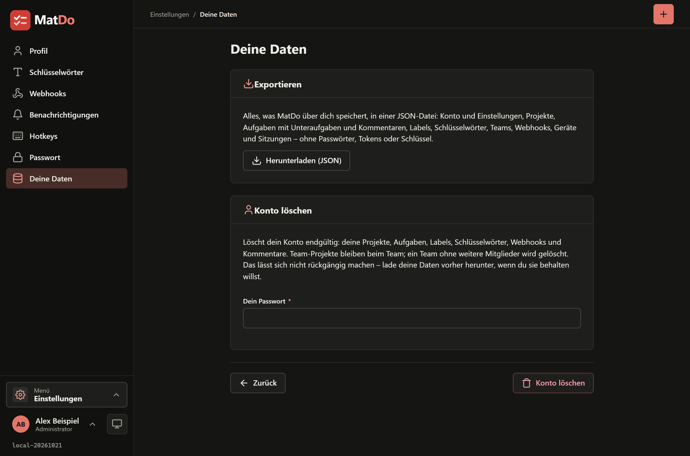 |

| Smartphone | | | |
|---|---|---|---|
| 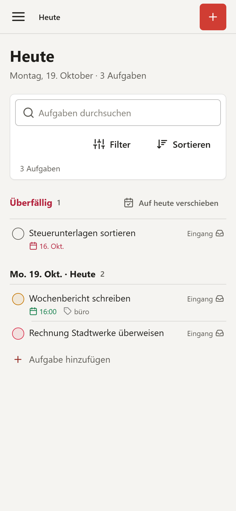 | 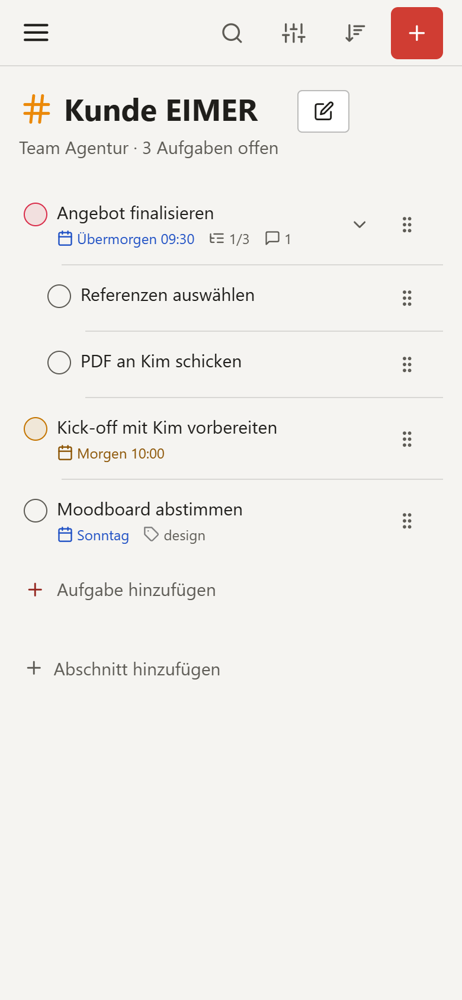 | 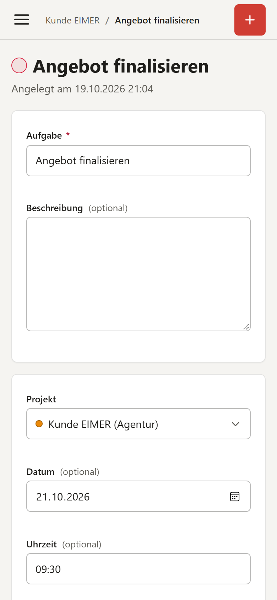 | 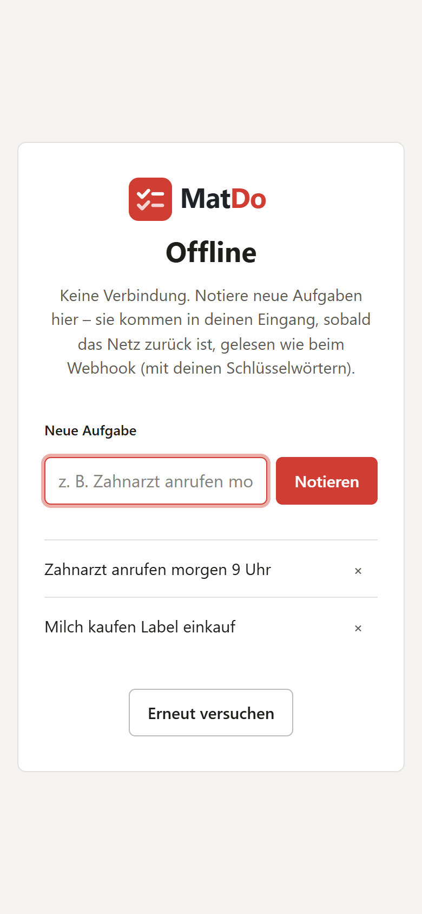 |

## Starten

```bash
docker compose up -d                                  # Release (Branch main, Image :latest)
docker compose -f docker-compose.dev.yml up -d        # Development (Branch dev, Image :nightly) mit pgAdmin auf 6007
docker compose -f docker-compose.local.yml up -d --build   # lokal aus dem Quellcode, mit pgAdmin (6007) und Postgres auf 6008
```

Dann **http://localhost:6006** öffnen und registrieren – das erste Konto ist Administrator. Danach ist die Registrierung **geschlossen**: weitere Konten legt ein Administrator an (*Administration → Benutzer*), oder er öffnet die Registrierung (*Administration → System*).

| Datei | Branch | Image | Dienste |
|---|---|---|---|
| `docker-compose.yml` | main | `ghcr.io/real-ttx/matdo:latest` | web, db |
| `docker-compose.dev.yml` | dev | `ghcr.io/real-ttx/matdo:nightly` | web, db, pgadmin |
| `docker-compose.local.yml` | – | lokal gebaut (`matdo:local`) | web, db, pgadmin |

Volumes je Stack: `web-data` (Schlüssel der Sitzungen) und `db-data` (PostgreSQL), bei dev/local zusätzlich `pgadmin-data`. Die Compose-Dateien brauchen keine Variablen; Verbindung (`Host=db;Database=matdo;Username=matdo;Password=matdo`) und Port stehen im Image. Für den Betrieb im Internet das Datenbank-Passwort in der Compose-Datei **und** per `ConnectionStrings__Default` ändern und einen TLS-Proxy (Caddy, Traefik) davorsetzen.

### Einstellungen (Umgebung)

Keine davon ist nötig; ohne sie läuft MatDo allein mit eigenen Konten.

| Variable | Bedeutung |
|---|---|
| `ConnectionStrings__Default` | Verbindung zu PostgreSQL (Standard im Image: `Host=db;Port=5432;Database=matdo;Username=matdo;Password=matdo`) |
| `DataDirectory` | Ordner der Schlüssel für die Sitzungen (Standard `/data`, das Volume `web-data`) |
| `MAT_API_KEY` | Schlüssel für die Plattform-API `/api/*` (Header `X-Api-Key`); leer = nur mit einem Token von MatIdentity. Mattiverse setzt ihn |
| `MATIDENTITY_AUTHORITY` | Adresse von MatIdentity (`https://id.example.com`); gesetzt = Anmeldung über MatIdentity |
| `MATIDENTITY_CLIENT_ID` | Client von MatDo in MatIdentity (Standard: `matdo`) |
| `MATIDENTITY_CLIENT_SECRET` | sein Geheimnis |
| `MATIDENTITY_INTERNAL_URL` | optional: wo MatDo MatIdentity im Docker-Netz erreicht (`http://matidentity:2300`); der Browser nutzt weiter `MATIDENTITY_AUTHORITY` |

MatDo verschickt keine E-Mails (Erinnerungen und Tagesübersicht kommen als Web Push), daher gibt es keine `MATSMTP_*`-Variablen.

## Plattform (Mattiverse, MatIdentity)

MatDo erfüllt den Plattform-Vertrag der Mat-Apps ([MatDesign `docs/PLATFORM.md`](https://github.com/Real-TTX/MatDesign/blob/main/docs/PLATFORM.md), Paket MatPlatform 1.4.0 in `src/MatDo/MatPlatform`, eine Kopie): Mattiverse und andere Apps können MatDo anzeigen, überwachen und einrichten, ohne es vorher zu kennen.

| Endpunkt | Inhalt | Zugriff |
|---|---|---|
| `GET /api` | Beschreibung (MatApiDefinition): Seiten *Übersicht* und *Einstellungen*, Kacheln, Felder, Schaltflächen, Rollen `admin`/`user` | anonym |
| `GET /api/health` | `ok` / `degraded` (kein aktiver Administrator) / `down` (Datenbank weg); 200 bzw. 503 – der Docker-`HEALTHCHECK` fragt hier | anonym |
| `GET /api/state[/{key}]` | Kacheln: aktive Benutzer, Teams, Projekte, offene und überfällige Aufgaben, erledigt in 7 Tagen, aktive Webhooks, Geräte mit Benachrichtigungen, Registrierung, letzte Änderung | Schlüssel oder Token |
| `GET`/`PUT /api/configure` | Registrierung offen, öffentliche Adresse – dieselben Werte wie *Administration → System* | Schlüssel oder Token |
| `POST /api/actions/cleanUp` | Aufräumen: beendete Sitzungen und vor über 30 Tagen gelöschte Aufgaben und Kommentare endgültig entfernen | Schlüssel oder Token |

Die übrigen Schaltflächen sind Links (*Öffnen* `/Today`, *Benutzer* `/Admin/Users`, *System* `/Admin/System`). Änderungen über die API stehen mit dem Aufrufer im Log.

**Anmeldung über MatIdentity** (nur mit `MATIDENTITY_AUTHORITY`): Wer nicht angemeldet ist, landet direkt bei MatIdentity (OpenID Connect, Code mit PKCE) und kommt angemeldet zurück. Die Person wird über `sub` gefunden, sonst als neues Konto angelegt (mit Eingang und Schlüsselwörtern, ohne Passwort). Ein bestehendes Konto mit derselben Adresse wird **nicht** über die Adresse übernommen: Es wird erst verbunden, nachdem es sich einmal mit seinem Passwort angemeldet hat (`/Account/Login?local=1&link=1`, mit Abbrechen). Der Claim `role` (`admin`/`user`) gilt bei jeder Anmeldung, der letzte aktive Administrator wird nie herabgestuft; ohne Claim vergibt MatDo die Rollen selbst.

- Lokale Anmeldung (z. B. wenn MatIdentity nicht erreichbar ist): `/Account/Login?local=1`
- Adressen für den Client in MatIdentity: Redirect `/signin-oidc`, nach der Abmeldung `/signout-callback-oidc`, Back-Channel-Logout `/signout-backchannel`
- Abmelden beendet auch die Sitzung bei MatIdentity; meldet MatIdentity eine Person ab (oder beendet ein Administrator dort ihre Sitzungen), endet ihre Sitzung in MatDo bei der nächsten Anfrage (Back-Channel-Logout)

## Webhook

```bash
curl -X POST "https://todo.example.com/api/v1/webhook/<token>" \
  -H "Content-Type: application/json" \
  -d '{"text": "Milch kaufen morgen 17 Uhr #Einkauf p2", "description": "laktosefrei"}'
```

- Body: JSON (`text`, optional `description`), ein Formular (`text=…`) oder reiner Text
- Alternativ `POST /api/v1/webhook` mit `Authorization: Bearer <token>`
- Antwort `201`: `id`, `content`, `project`, `due`, `time`, `dueText`, `recurrence`, `deadline`, `priority`, `labels`, `url`, `message` (ein Satz für die Mitteilung)
- `400` ohne Titel, `404` für einen unbekannten oder abgeschalteten Token, `429` nach 60 Aufrufen pro Minute

**Apple Kurzbefehl:** *Text diktieren* → *Inhalte von URL abrufen* (POST, JSON, `text` = Diktierter Text) → optional *Wörterbuchwert* `message` → *Mitteilung zeigen*. Die Anleitung steht auch in der App beim Webhook.

## Entwicklung

- .NET 10, ASP.NET Core **Razor Pages**, EF Core + **PostgreSQL**, MatUi-Toolkit von MatDesign (kopiert nach `wwwroot/matui`)
- `dotnet build MatDo.slnx`, `dotnet test` (Parser, Wiederholungen; die Tests der Plattform und der Anmeldung starten die App und brauchen PostgreSQL: `MATDO_TEST_DB="Host=localhost;Port=5432;Username=postgres;Password=…"`, jede Testklasse legt dort eine eigene Datenbank an und löscht sie wieder – ohne die Variable werden sie übersprungen)
- `./scripts/redeploy.ps1` baut den Container neu und startet den lokalen Stack (`-Clean` = leere Datenbank)
- Migrationen: `dotnet ef migrations add <Name> -p src/MatDo -o Data/Migrations` (werden beim Start angewendet)
- Texte: `src/MatDo/Resources/Texts/*.json` (`{"en": …, "de": …}` je Schlüssel); ein Test prüft, dass jeder benutzte Schlüssel in beiden Sprachen existiert
- `robots.txt` (nur die Startseite ist öffentlich) und [`llms.txt`](src/MatDo/wwwroot/llms.txt)

### Versionierung und Branches

| Branch | Kanal | Version | Image-Tags |
|---|---|---|---|
| `main` | Release | `0.1.<build>-<datum>` | `<version>`, `latest`, `release` |
| `dev` | Nightly | `nightly-<build>-<datum>` | `<version>`, `nightly` |
| andere / lokal | Local | `local-<datum>` | – |

Major/Minor stehen in `Directory.Build.props`; die GitHub Action `.github/workflows/build.yml` baut, testet und veröffentlicht die Images (amd64 + arm64) nach `ghcr.io/real-ttx/matdo`.

## Logo

| Favicon (16–32 px) | App-Icon | Maskable (PWA) | Logo hell | Logo dunkel | Einfarbig |
|---|---|---|---|---|---|
|  |  |  |  |  |  |

Eine kurze Checkliste (zwei Haken, zwei Zeilen) auf dem MatDo-Rot **#D03D33** – nah an Todoists Rot, etwas dunkler und wärmer; weiße Schrift darauf erreicht 4,78:1 (WCAG AA). Das Favicon reduziert die Marke auf einen Haken, damit sie bei 16 px lesbar bleibt.
